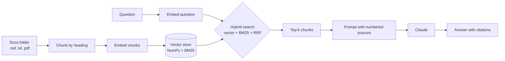

# 📚 RAG Assistant

Ask questions about **your own documents** and get short answers **with citations**. Point it at a folder of Markdown, text or PDF files, and it finds the relevant parts and answers using only those.

I built it from scratch to learn the core parts of AI engineering without hiding them behind a framework: chunking, embeddings, vector search, hybrid search, prompting an LLM, guardrails and evaluation.

```
$ python -m rag_assistant ask "What is the API rate limit?" -k 2

Rate limit: 60 requests per minute per token. [1] The API lets you read, create and update notes. [1] ...

  [1] Integrations & API > REST API  (integrations.md, similarity 0.32)
  [2] Integrations & API > Calendar  (integrations.md, similarity 0.08)
  mode: offline
```

The repo comes with a demo document set: the help center for **Nimbus Notes**, a made-up note-taking app (pricing, sync, security, troubleshooting, integrations). Swap in your own folder with `ingest --docs`.

## What's inside

| Piece | What it does | File |
|---|---|---|
| Loading | Reads every `.md`, `.txt` and `.pdf` in a folder | `loaders.py` |
| Chunking | Splits Markdown by `##` heading, then by length with overlap; puts the heading at the top of each chunk | `chunking.py` |
| Embeddings | Turns text into vectors. Real model: `bge-small` via fastembed (CPU, no API key). Offline: a hashing embedder | `embeddings.py` |
| Vector store | Written from scratch in NumPy: cosine search, BM25 keyword search, and **hybrid** search with Reciprocal Rank Fusion | `vectorstore.py` |
| Generation | Claude answers using only the numbered sources and cites them `[1]`. Without a key, an offline mode picks the best sentences | `llm.py`, `rag.py` |
| Guardrails | Says "I couldn't find that" instead of guessing; the prompt tells the model to ignore instructions hidden in documents (prompt injection) | `rag.py` |
| Evaluation | 25 test questions: retrieval hit@k, MRR, answer accuracy, and a comparison of search modes | `evaluate.py`, `eval/questions.jsonl` |
| UI | Streamlit chat with a sources panel and settings for k and the search mode | `app.py` |
| Tests + CI | 13 pytest tests and the evaluation, run on every push with GitHub Actions | `tests/`, `.github/workflows/` |

## How it works



## Run it

```bash
git clone https://github.com/jhwang2525/rag-assistant.git
cd rag-assistant
python -m venv .venv && source .venv/bin/activate   # Windows: .venv\Scripts\activate
pip install -r requirements.txt

# optional: use Claude for answers (without it the app runs in offline mode)
export ANTHROPIC_API_KEY=your-key            # Windows: set ANTHROPIC_API_KEY=your-key

export PYTHONPATH=src                         # Windows: set PYTHONPATH=src
python -m rag_assistant ingest                # index the demo docs
python -m rag_assistant ask "Is there a student discount?"
python -m rag_assistant chat                  # chat in the terminal
python -m rag_assistant eval                  # run the evaluation
streamlit run app.py                          # web chat UI
```

**Use your own documents** (class notes, a product manual, company docs…):

```bash
python -m rag_assistant ingest --docs path/to/your/folder
```

**Settings (environment variables)**
- `ANTHROPIC_API_KEY`: turns on Claude answers.
- `RAG_MODEL`: Claude model (default `claude-haiku-5-5`).
- `RAG_EMBEDDER`: `auto` (default), `fastembed` or `hashing`.

## Evaluation

`python -m rag_assistant eval` runs 25 questions. 24 of them can be answered from the docs; one ("Who won the 1998 World Cup?") should get "I couldn't find that".

Results with the **offline hashing embedder and offline answers** (no model download, no API key). This is what CI runs:

| Search mode | hit@4 | MRR |
|---|---|---|
| vector | 100% | 0.94 |
| keyword (BM25) | 100% | 0.97 |
| **hybrid (RRF)** | **100%** | **0.98** |

Answer accuracy (expected facts present in the answer): **96%**.

> To try: run the eval with `--embedder fastembed` and an `ANTHROPIC_API_KEY`, and compare the numbers.

## Things I learned

- **Chunking matters more than I expected.** Putting the section heading at the top of each chunk ("Plans & Pricing > Pro plan") made retrieval better, because a chunk like "It costs $6 per month" doesn't say *what* costs $6.
- **Hybrid search is worth it.** Vectors find meaning ("can I get my money back" ≈ refunds). BM25 finds exact words like "SMS", "Frankfurt" or "60 requests". RRF merges the two rankings without tuning weights, and it scored best in my eval.
- **Measure before you tweak.** The eval caught that a 512-dim hashing embedder had too many hash collisions. It also showed that the offline answer picker improved from 72% to 96% once it trusted the top-ranked source more.
- **Guardrails are part of the product.** The assistant has to say "I don't know" instead of inventing a policy. It also has to treat document text as data, not as instructions.

## Ideas for next steps

- Re-ranking the top 20 results with a cross-encoder
- Streaming responses in the UI
- Multi-turn memory ("and what about the Team plan?")
- LLM-as-judge evaluation for answers, not just keyword checks
- Upload documents straight from the web UI
- Deploy on Streamlit Community Cloud

## Project structure

```
rag-assistant/
├── app.py                    # Streamlit UI
├── data/docs/                # demo docs (made-up "Nimbus Notes" help center)
├── eval/questions.jsonl      # evaluation set
├── src/rag_assistant/
│   ├── loaders.py  chunking.py  embeddings.py
│   ├── vectorstore.py  llm.py  rag.py
│   ├── evaluate.py  cli.py
└── tests/test_pipeline.py
```
